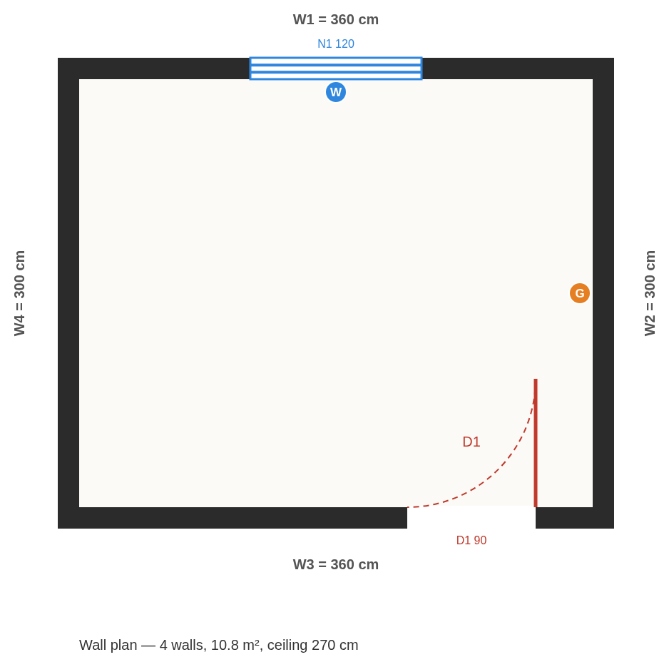
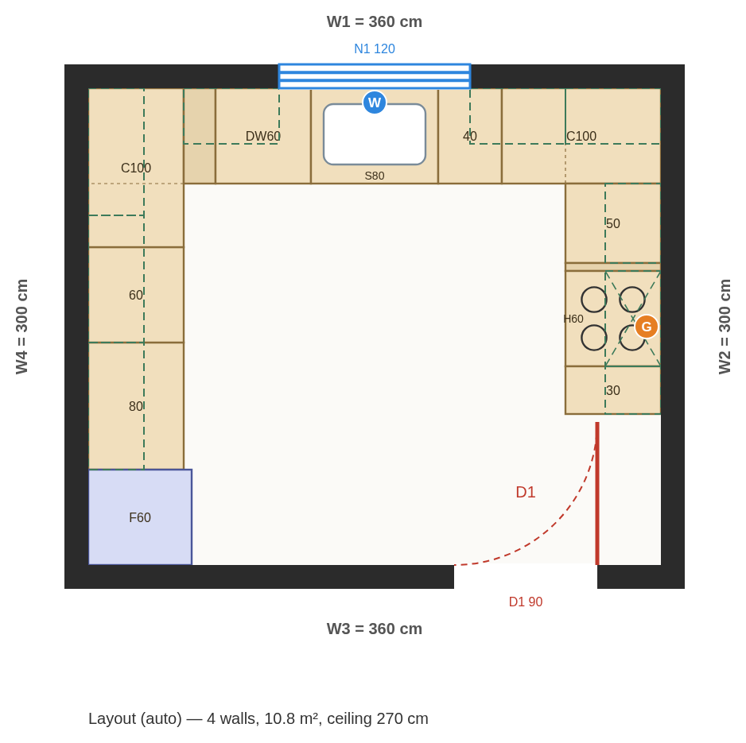
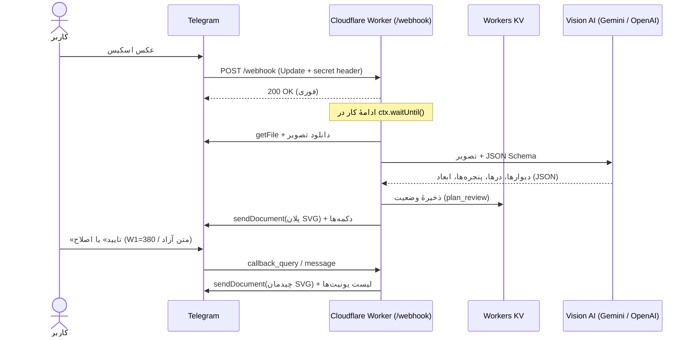

<div dir="rtl">

# 🍳 ربات تلگرام سرورلس طراحی آشپزخانه

ربات تلگرامی که **عکس اسکیس دستی نقشهٔ آشپزخانه** را می‌گیرد، با **Vision AI** دیوارها، درها، پنجره‌ها و ابعاد را به صورت ساختاریافته (JSON) استخراج می‌کند، **پلان دوبعدی دیوارها** را رسم می‌کند و پس از تایید کاربر **چیدمان یونیت‌ها** (خطی / L / U) و لیست کابینت‌ها را تحویل می‌دهد.

- ⚡️ **کاملاً سرورلس**: روی [Cloudflare Workers](https://developers.cloudflare.com/workers/) اجرا می‌شود و هیچ سرور همیشه روشن یا Polling ندارد. هر پیام تلگرام از طریق **Webhook** یک اجرای کوتاه از تابع را فعال می‌کند.
- 💸 **استقرار رایگان**: پلن رایگان Cloudflare Workers و KV، به همراه پلن رایگان Google Gemini. OpenAI یا هر API سازگار با آن هم پشتیبانی می‌شود.
- 🔐 **امن**: وب‌هوک با `secret_token` و هدر `X-Telegram-Bot-Api-Secret-Token` اعتبارسنجی می‌شود و می‌توانید دسترسی را به کاربران مشخص محدود کنید.
- 🚀 **CI/CD**: با هر push به `main`، GitHub Actions تست‌ها را اجرا می‌کند و سپس Worker را مستقر کرده و وب‌هوک تلگرام را ثبت می‌کند.

| پلان دوبعدی دیوارها | چیدمان یونیت‌ها (پس از تایید) |
|---|---|
|  |  |

## جریان کار ربات



## ساختار پروژه

```
kitchen-sketch-serverless-bot/
├── src/
│   ├── index.ts              # نقطهٔ ورود Worker: /webhook ، /view/:id ، /
│   ├── env.ts                # تایپ متغیرها و Bindingها
│   ├── telegram/
│   │   ├── api.ts            # کلاینت سبک Bot API بر پایهٔ fetch (sendDocument، getFile، ...)
│   │   ├── security.ts       # بررسی secret token وب‌هوک و لیست کاربران مجاز
│   │   └── types.ts          # تایپ‌های Update/Message/CallbackQuery
│   ├── handlers/
│   │   ├── update.ts         # مسیریابی آپدیت‌ها: دستورها، عکس، متن، دکمه‌ها
│   │   ├── flow.ts           # مراحل: تحلیل → پلان → چیدمان → نهایی
│   │   ├── messages.ts       # متن‌های فارسی، کپشن‌ها و کیبوردها
│   │   └── context.ts        # ساخت وابستگی‌ها برای هر درخواست
│   ├── vision/
│   │   ├── prompt.ts         # پرامپت تخصصی خواندن اسکیس
│   │   ├── gemini.ts         # Google Gemini (خروجی JSON Schema)
│   │   ├── openai.ts         # OpenAI / سرویس‌های سازگار
│   │   └── index.ts          # انتخاب Provider
│   ├── domain/
│   │   ├── schema.ts         # مدل داده + JSON Schema + اعتبارسنجی و ترمیم خروجی AI
│   │   ├── plan.ts           # هندسهٔ پلان دوبعدی (چندضلعی دیوارها، کنج‌ها)
│   │   └── layout.ts         # الگوریتم چیدمان یونیت‌ها (سینک، گاز، یخچال، کنج، ماژول‌ها)
│   ├── render/svg.ts         # رسم پلان و چیدمان به SVG
│   └── storage/session.ts    # وضعیت گفتگو و نقشه‌ها در Workers KV
├── test/                     # تست‌های Vitest (دامنه، رندر، جریان کامل وب‌هوک با Mock)
├── scripts/
│   ├── telegram-webhook.mjs  # set / info / delete وب‌هوک + ثبت دستورهای ربات
│   ├── ensure-kv.mjs         # ساخت خودکار KV namespace در CI
│   └── render-sample.ts      # رندر نمونه بدون تلگرام و AI
├── examples/                 # JSON نمونه و خروجی‌های SVG
├── docs/
│   ├── DEPLOYMENT.md         # راهنمای کامل استقرار و تنظیم وب‌هوک
│   └── ARCHITECTURE.md       # معماری، مدل داده و الگوریتم چیدمان
├── .github/workflows/
│   ├── ci.yml                # تست روی PRها
│   └── deploy.yml            # استقرار خودکار با push به main
├── wrangler.toml             # کانفیگ استقرار Cloudflare Workers
├── package.json · tsconfig.json · vitest.config.ts
└── .dev.vars.example         # نمونهٔ متغیرهای محرمانه برای توسعهٔ محلی
```

## شروع سریع

```bash
git clone https://github.com/<you>/kitchen-sketch-serverless-bot.git
cd kitchen-sketch-serverless-bot
npm ci
npm test                 # تست‌ها
npm run render:sample    # ساخت examples/*.svg از روی examples/sample-sketch.json
```

مراحل استقرار رایگان را در [docs/DEPLOYMENT.md](docs/DEPLOYMENT.md) ببینید. خلاصهٔ آن:

1. از [@BotFather](https://t.me/BotFather) توکن ربات بگیرید.
2. از [Google AI Studio](https://aistudio.google.com/apikey) کلید رایگان Gemini بگیرید.
3. در Cloudflare یک API Token با قالب «Edit Cloudflare Workers» بسازید و Account ID را بردارید.
4. این مقادیر را در **Settings → Secrets and variables → Actions** مخزن گیت‌هاب ثبت کنید:
   `CLOUDFLARE_API_TOKEN`، `CLOUDFLARE_ACCOUNT_ID`، `TELEGRAM_BOT_TOKEN`، `TELEGRAM_WEBHOOK_SECRET`، `GEMINI_API_KEY`
5. به `main` پوش کنید. GitHub Actions به ترتیب تست، ساخت KV، استقرار، آپلود Secretها و ثبت وب‌هوک را انجام می‌دهد ✅

## نحوهٔ استفاده در تلگرام

| اقدام | نتیجه |
|---|---|
| ارسال عکس اسکیس (یا فایل تصویر برای کیفیت بالاتر) | تحلیل و ارسال پلان دوبعدی + دکمه‌های «تایید / اصلاح / تحلیل مجدد» |
| `W1=380 W3=250` یا `H=260` | اصلاح عددی ابعاد و رسم دوبارهٔ پلان؛ اعداد فارسی هم قبول است |
| متن آزاد، مثل «پنجره روی دیوار W2 است» | تحلیل دوبارهٔ تصویر با اعمال اصلاحیهٔ کاربر |
| دکمهٔ «تایید و چیدمان یونیت‌ها» | چیدمان خودکار + فایل SVG + لینک مشاهده در مرورگر |
| دکمه‌های «خطی / L / U» | تغییر نوع چیدمان |
| دکمهٔ «نهایی» | لیست کامل یونیت‌ها (BOM) |
| `/new` ، `/plan` ، `/help` | شروع طرح جدید، نمایش دوبارهٔ پلان، راهنما |

## مجوز

MIT

</div>
