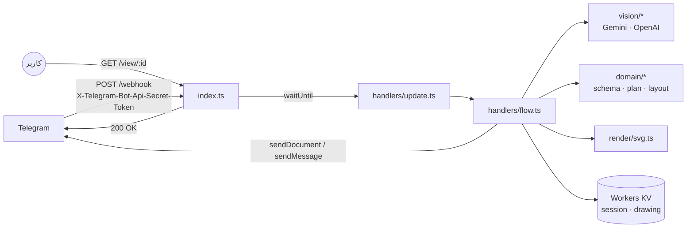
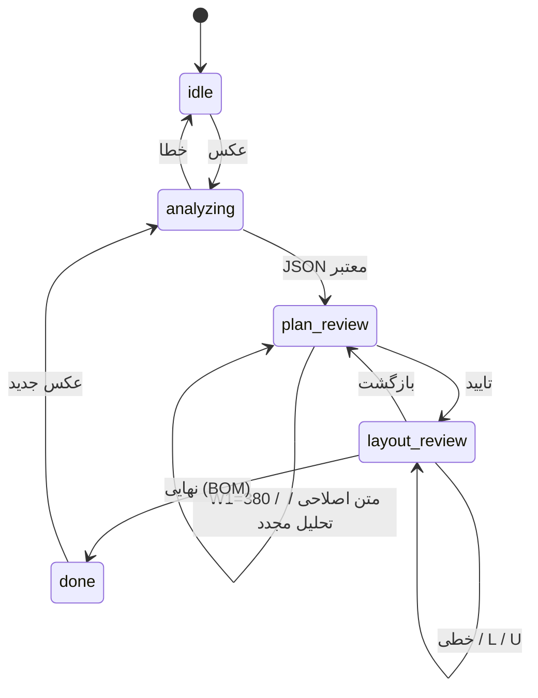

<div dir="rtl">

# 🏛 معماری

## اصول طراحی

1. **بدون سرور و بدون وضعیت در حافظه**: هر درخواست وب‌هوک یک اجرای مستقل است. وضعیت گفتگو در Workers KV نگه‌داری می‌شود.
2. **پاسخ فوری به تلگرام**: `POST /webhook` بعد از اعتبارسنجی امضا بلافاصله `200` برمی‌گرداند و کار اصلی در `ctx.waitUntil()` ادامه پیدا می‌کند. به این ترتیب تلگرام Timeout نمی‌گیرد و آپدیت را دوباره نمی‌فرستد.
3. **AI فقط برای خواندن تصویر**: مدل Vision خروجی JSON ساختاریافته با Schema مشخص تولید می‌کند. هندسه، اعتبارسنجی، چیدمان و رسم همگی **کد قطعی و تست‌پذیر** هستند. نتیجه این است که هزینه کم است، رفتار قابل پیش‌بینی است و کاربر هر مرحله را کنترل می‌کند.
4. **انسان در حلقه**: چیدمان فقط بعد از اینکه کاربر پلان دیوارها را تایید کند ساخته می‌شود.
5. **قابل حمل**: لایه‌های `domain`، `render`، `vision` و `telegram` فقط به `fetch` و Web APIها وابسته‌اند.



## ماشین حالت گفتگو



## مدل داده (خروجی Vision AI)

قراردادها: واحد همه‌جا **سانتی‌متر** است و فقط اتاق‌های **متعامد** (دیوارهای عمود بر هم) پشتیبانی می‌شوند. دیوارها **ساعتگرد** و از **گوشهٔ بالا-چپ به سمت شرق** فهرست می‌شوند. `offset` هر بازشو از ابتدای دیوار خودش اندازه‌گیری می‌شود.

```json
{
  "unit": "cm",
  "ceilingHeight": 270,
  "walls": [
    { "id": "W1", "length": 360, "direction": "east" },
    { "id": "W2", "length": 300, "direction": "south" },
    { "id": "W3", "length": 360, "direction": "west" },
    { "id": "W4", "length": 300, "direction": "north" }
  ],
  "openings": [
    { "id": "N1", "type": "window", "wallId": "W1", "offset": 120, "width": 120, "sillHeight": 100 },
    { "id": "D1", "type": "door",   "wallId": "W3", "offset": 40,  "width": 90 }
  ],
  "fixtures": [
    { "type": "water", "wallId": "W1", "offset": 180 },
    { "type": "gas",   "wallId": "W2", "offset": 150 }
  ],
  "confidence": 0.86,
  "notes": []
}
```

همین Schema با `responseSchema` به Gemini داده می‌شود و در پرامپت OpenAI هم آمده است. خروجی مدل همیشه از `normalizeSketch()` عبور می‌کند. این تابع:

- اعداد را تبدیل می‌کند و شناسه‌های نامعتبر را حذف می‌کند
- دیوارهای هم‌راستای پشت سر هم را ادغام می‌کند و عمود بودن دیوارهای متوالی را بررسی می‌کند
- اگر جمع ابعاد چندضلعی را نبندد، خطا را روی آخرین دیوار افقی یا عمودی اصلاح می‌کند و یک یادداشت اضافه می‌کند
- بازشوها را داخل محدودهٔ دیوار نگه می‌دارد

## هندسهٔ پلان (`domain/plan.ts`)

- مختصات SVG: محور x به راست، محور y به پایین و مبدا در ابتدای W1
- در پیمایش ساعتگرد روی صفحه، داخل اتاق سمت **راست** جهت حرکت است: `inward = (-dy, dx)`
- **کنج داخلی** (جایی که کابینت‌ها به هم می‌رسند) همان چرخش به راست است، یعنی ضرب خارجی بزرگ‌تر از صفر. کنج بیرونی در اتاق‌های L شکل جدا تشخیص داده می‌شود.

## الگوریتم چیدمان (`domain/layout.ts`)

| مرحله | قاعده |
|---|---|
| ۱. فضای آزاد هر دیوار | کل طول دیوار منهای درها (با ۵ سانت فاصله)، منهای پنجره‌هایی که ارتفاع کف‌شان کمتر از ۸۵ است، منهای **محدودهٔ بازشوی درهای دیوارهای مجاور** |
| ۲. انتخاب دیوارها | امتیاز دیوار = طول آزاد + امتیاز نقطهٔ آب + امتیاز پنجره. دیوار اصلی بیشترین امتیاز را دارد. U برای دیوار اصلی ۲۷۰ سانت یا بیشتر که دو دیوار مجاورش هر کدام ۱۵۰ سانت فضای آزاد دارند، L برای حالتی که یک دیوار مجاور ۱۲۰ سانت یا بیشتر فضای آزاد دارد، و در غیر این صورت خطی. انتخاب کاربر بر این قواعد مقدم است و اگر ممکن نباشد با هشدار به نوع ساده‌تر برمی‌گردد |
| ۳. کنج | دیوار اول کنج را با یونیت **Blind Corner** به عرض ۱۰۰ نگه می‌دارد و دیوار بعدی از ۶۰ سانتی کنج شروع می‌شود |
| ۴. سینک ۸۰ | به ترتیب اولویت: نقطهٔ آب یا فاضلاب، زیر پنجره، وسط دیوار اصلی |
| ۵. ماشین ظرفشویی ۶۰ | کنار سینک |
| ۶. گاز ۶۰ | نزدیک‌ترین جا به لولهٔ گاز یا دودکش. اگر وجود نداشته باشد، فاصلهٔ حدود ۱۵۰ سانت از سینک (مثلث کار). حداقل ۳۰ سانت کانتر در دو طرف، و هرگز زیر پنجره |
| ۷. یخچال ایستاده ۶۰ | انتهای یک ران، نزدیک‌ترین نقطه به در، و دور از گاز |
| ۸. پر کردن فضای باقی‌مانده | برنامه‌نویسی پویا روی عرض‌های استاندارد `80، 60، 50، 45، 40، 30` با کمترین تعداد ماژول و اولویت با عرض ۶۰. باقی‌مانده به عنوان فیلر |
| ۹. کابینت دیواری (عمق ۳۵) | بالای کابینت‌های زمینی، به جز روی پنجره، در، یخچال و گاز. به جای کابینت بالای گاز **هود** قرار می‌گیرد |

ابعاد پیش‌فرض در `DIMENSIONS` قابل تغییر هستند: عمق زمینی ۶۰، ارتفاع ۸۵، عمق دیواری ۳۵ و ارتفاع ۷۰، عمق یونیت بلند ۶۵ و ارتفاع ۲۱۰.

## خروجی‌ها

- **SVG** با واحد سانتی‌متر (`render/svg.ts`) به صورت فایل (`sendDocument`) برای کاربر فرستاده می‌شود. همچنین در KV ذخیره می‌شود و از طریق `GET /view/:id` در مرورگر نمایش داده می‌شود (دکمهٔ «مشاهده در مرورگر»). در این صفحه هدر CSP سخت‌گیرانه تنظیم شده است.
- **BOM**: لیست تعداد و عرض یونیت‌ها به صورت پیام متنی.

> چرا PNG ساخته نمی‌شود؟ تبدیل SVG به PNG (مثلاً با resvg-wasm) از سقف ۱۰ میلی‌ثانیه CPU پلن رایگان بیشتر می‌شود. اگر از پلن Paid استفاده می‌کنید، می‌توانید آن را در `flow.ts` اضافه کنید و نتیجه را با `sendPhoto` بفرستید.

## امنیت

- اعتبارسنجی `X-Telegram-Bot-Api-Secret-Token` با مقایسه در زمان ثابت
- `ALLOWED_USER_IDS` برای ربات خصوصی
- Secretها فقط به صورت Worker Secret و GitHub Secret نگه‌داری می‌شوند. در CI فایل موقت با `umask 077` ساخته و بعد از استفاده حذف می‌شود
- شناسهٔ نقشه‌ها یک UUID تصادفی ۱۲۸ بیتی است و نقشه‌ها با TTL خودکار حذف می‌شوند

</div>
